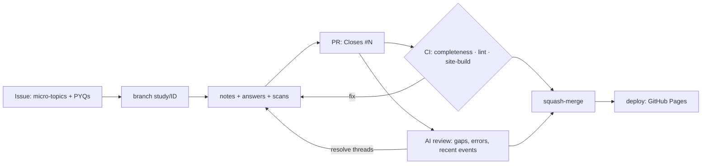

# upsc-gs-mains

Learning in public: UPSC CSE Mains **GS1–GS3**, Oct 2026 → Feb 2027.

📖 **Revision site:** <https://nononsenseupsctamil.github.io/upsc-gs-mains/> — notes, handwritten PYQ answers,
*Revise today* and *Progress*.

## How it works



1. The official syllabus is split into **88 topics** (`syllabus/issues.yaml`), each split into micro-topics.
   Every topic is a GitHub issue that lists that topic's past Mains questions (PYQs, 2013–2026) and a
   PYQ-based strategy (`syllabus/strategy.yaml`): what UPSC asks, what to read for, how to answer.
2. For each issue: write notes (one heading per micro-topic, plus any of your own) — typed, or handwritten and scanned for
   Claude to transcribe — answer each PYQ from 2022 onwards by hand under time, scan it, and open a PR that
   `Closes #N`.
3. **CI** checks that the notes exist and every required PYQ has a quoted question and a scan.
   **Claude** reviews the notes and answers against [the rubric](.github/REVIEW_RUBRIC.md), flags gaps and
   factual errors, and suggests verified recent events. Every review thread must be resolved before merge.
4. **On merge** the site rebuilds. Each topic comes back on *Revise today* 1, 7, 30 and 90 days later.

| Paper | Topics | Done by |
|---|---|---|
| GS1 | 32 | 1 Dec 2026 |
| GS2 | 29 | 7 Jan 2027 |
| GS3 | 27 | 12 Feb 2027 |

## Working on a topic

```bash
git switch -c study/GS2-POL-04
python scripts/create_issues.py --scaffold GS2-POL-04   # note + pyqs.md skeletons
# … write, answer, scan into answers/gs2/GS2-POL-04/img/<PYQ-ID>.jpg …
scripts/compress_images.sh                              # HEIC → JPG, ≤ ~600 KB
python scripts/check_completeness.py --local GS2-POL-04
python scripts/lint.py
python scripts/build_site.py && zensical serve          # preview the site
```

Set up locally with `python3 -m venv .venv && . .venv/bin/activate && pip install -r requirements.txt`.

## PYQ bank

GS1–3 questions from **2013–2026** (2019 only partly) in `data/pyqs/`, all `verified: false` until compared with
the official PDF. 2022–25 carry their paper question numbers (`…-Q07`); older years and 2026 come from a
subject-wise compilation without them (`…-S01`). CI requires answers for **2022 onwards**; older questions are
listed in each issue for practice. **This repo never AI-generates or paraphrases exam questions.**

## Licence

Own notes, answers and code: [CC BY-NC 4.0](LICENSE). UPSC question text is excluded — see [NOTICE](NOTICE.md).
