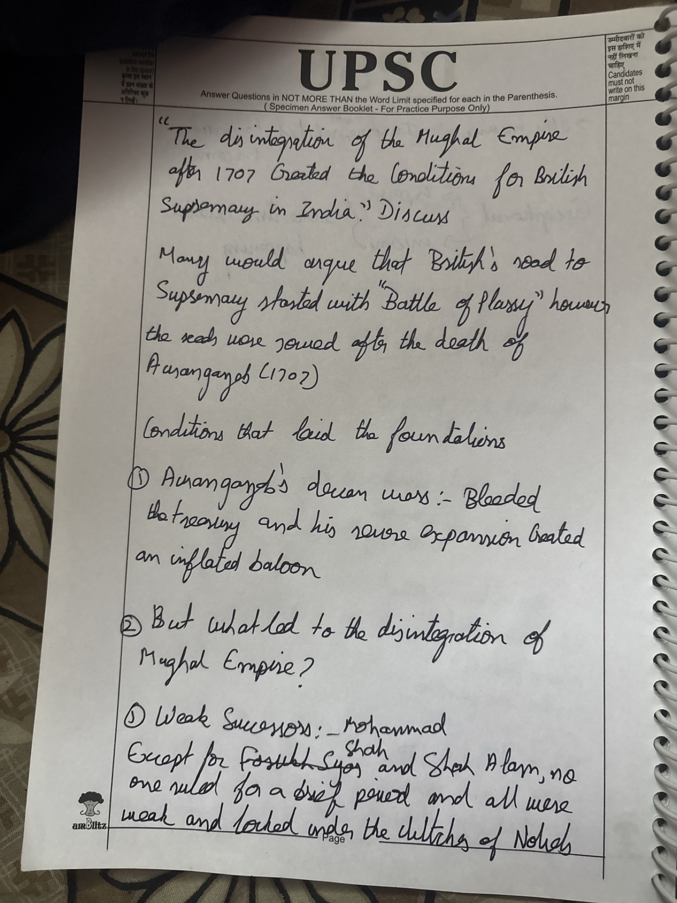
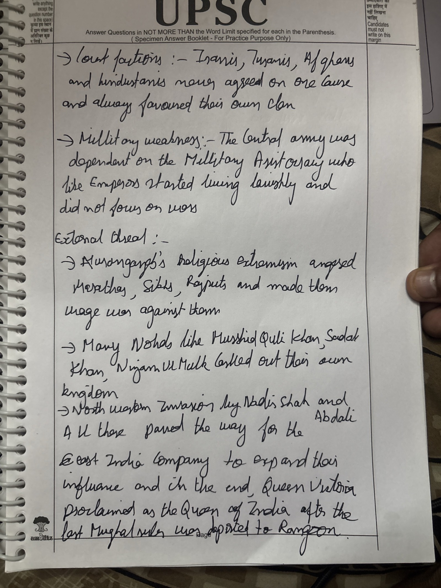

# GS1-HIS-01 · Practice answers

Self-set practice questions (not from the PYQ bank), with Claude's evaluation.

## Practice 01 — Mughal disintegration and British supremacy (15 Oct 2026)

> "The disintegration of the Mughal Empire after 1707 created the conditions for British supremacy in India." Discuss. *(evaluated as 10M / 150 words)*

### Demand of the question

- **Discuss** → show *how*, with cause–effect links, and a brief other side.
- Keyword: **"created the conditions for British supremacy"** — the answer must be mostly about the chain *Mughal collapse → power vacuum and divided regional states → British exploitation*, not only about why the Mughals declined.

### Model answer (~170 words)

**Intro:** Aurangzeb's death (1707) left a vast but overstretched empire; within 60 years its collapse let a trading company — the EIC — become the real power (*diwani*, 1765).

**How disintegration created the conditions**

1. **Power vacuum** — successor states (Bengal, Awadh, Hyderabad) were nominally loyal but acted alone; no central power checked the Europeans → the EIC faced isolated nawabs (Plassey, 1757).
2. **Regional rivalries** — Marathas vs Nizam vs Mysore; succession disputes in the Carnatic and Bengal → the Company became the **kingmaker** (Mir Jafar, Mir Qasim).
3. **Mughal legitimacy up for grabs** — **Farman of 1717** (duty-free trade) and the **Diwani of 1765** handed Bengal's revenue to the Company to fund its army.
4. **Military collapse** — Nadir Shah (1739), Abdali and **Panipat (1761)** wrecked the Mughals and weakened the Marathas, the only possible all-India alternative.

**But** — decline was **necessary, not sufficient**: the British also had a disciplined sepoy army, artillery, naval supremacy, Bengal's revenue and London credit, skilled diplomacy, and they defeated the French in the Carnatic wars.

**Conclusion:** Mughal disintegration **opened the door**; British organisation and resources **walked through it** — supremacy by 1818.

### Evaluation

**Score: ~4 / 10** (average UPSC answer 3–4; toppers 5–6)

**Strengths**

- Strong intro hook — "most say Plassey, but the seeds were sown in 1707".
- Good coverage of causes of decline: Deccan wars and the "inflated balloon", weak successors, the four court factions, military weakness, regional nobles, Nadir Shah and Abdali.
- Clear headings and arrows; easy to read.

**Gaps**

1. **Answers "why did the Mughals decline?" rather than "how did the decline help the British?"** The British appear only in the last line — no Plassey, Buxar, diwani, Farman of 1717 or kingmaker role. This is where most marks are.
2. **No other side** — "discuss" needs one short paragraph on British strengths (army, navy, finance, diplomacy).
3. **Mislabelled heading** — "External threat" lists the Marathas, Sikhs, Rajputs and nobles, who are internal; only Nadir Shah and Abdali are external.
4. **Confusing structure** — "Conditions that laid the foundations", then "② But what led to the disintegration?", then numbering restarts at ①. Use 3–4 clean subheadings.

**Factual / wording errors**

- "Queen Victoria proclaimed Queen of India" — the Crown took over in 1858; "Empress of India" only in 1877.
- "Except Muhammad Shah and Shah Alam, no one ruled for a brief period" says the opposite of what was meant — write "no one else ruled for long" (Akbar II also ruled 31 years).
- Spellings: Aurangzeb, supremacy, Plassey, aristocracy, "bled", Saadat.

**Fixes for next time**

1. Underline the keyword before writing and end every point with "→ which helped the British by…".
2. Spend 60–70% of the answer on the demand and about 20% on causes.
3. Add one line of the other side and one flowchart.
4. Use 2–3 anchoring dates or events (1717, 1757, 1765, 1761).
